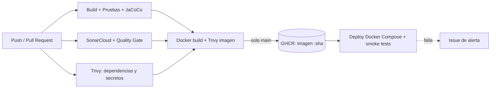

# Order Manager API

Microservicio REST (Spring Boot 3.5 · Java 17 · Maven) para gestionar pedidos de un e-commerce.
Este repositorio incluye el **pipeline CI/CD completo en GitHub Actions** de la Evaluación Parcial N°2 (DOY0101 – Ingeniería DevOps).

**Integrantes:** Cristhian LLontop 

## 1. Arquitectura



Entorno desplegado: `app` (API) + `db` (PostgreSQL 16) en una red interna; solo la API publica el puerto 8098.

## 2. Pipeline (`.github/workflows/ci-cd.yml`)

| Job | Qué hace | Se bloquea si… |
|---|---|---|
| `test` | `mvn verify`: 24 pruebas JUnit 5 / Mockito / MockMvc + cobertura JaCoCo | una prueba falla o la cobertura de líneas < 60 % |
| `sonar` | Análisis estático en SonarCloud (Java 21) | no pasa el Quality Gate |
| `scan-dependencies` | Trivy sobre el repositorio (vulnerabilidades en `pom.xml` y secretos) | hay vulnerabilidades HIGH/CRITICAL con parche y sin excepción |
| `docker` | Construye la imagen (multi-stage), la escanea con Trivy y, en `main`, la publica en GHCR | el escaneo de la imagen falla |
| `deploy` | Despliega con Docker Compose en el runner (entorno simulado) y ejecuta smoke tests | el contenedor no queda *healthy* o fallan los smoke tests |
| `notify-failure` | Abre un Issue automático con el enlace a la ejecución fallida | — (es la alerta) |

`docker` depende de `test`, `sonar` y `scan-dependencies`, y `deploy` depende de `docker`: **nada llega a despliegue si una etapa de calidad o seguridad falla**.

**Dependabot** (`.github/dependabot.yml`) abre PRs semanales para dependencias Maven, imagen base Docker y GitHub Actions.

**Excepciones de seguridad:** el archivo `.trivyignore` lista las vulnerabilidades que no pueden corregirse actualizando (la versión corregida no existe aún o exige migrar a Spring Boot 4), cada una con su justificación.

## 3. Contenedores y orquestación

- **`Dockerfile`**: multi-stage (Maven+JDK 17 → JRE 17 Alpine), caché de dependencias, `apk upgrade`, usuario no-root (UID 10001), `HEALTHCHECK` y `MaxRAMPercentage` para respetar los límites del contenedor.
- **`docker-compose.yml`**: API + PostgreSQL con `healthcheck`, `depends_on: service_healthy`, volumen persistente, red interna, límites de CPU/memoria, `read_only`, `cap_drop: ALL` y `no-new-privileges`.
- **`k8s/`**: manifiestos de Kubernetes como alternativa de orquestación: 2 réplicas, *rolling update*, probes de liveness/readiness, límites de recursos, `securityContext` restrictivo y **HPA** (2–5 réplicas al 70 % de CPU).

## 4. Seguridad y escalabilidad (parámetros ajustados)

| Aspecto | Medida |
|---|---|
| Secretos | Ninguno en el repo: `.env` ignorado, credencial de BD efímera en el deploy, `SONAR_TOKEN` como secret de GitHub |
| Imagen | Base mínima actualizada, no-root, escaneo Trivy, filesystem de solo lectura |
| Dependencias | Dependabot + Trivy; Spring Boot 3.5.15, PostgreSQL 42.7.12 y Jackson 2.21.7 fijados en el `pom.xml` |
| Permisos del pipeline | `permissions: contents: read` por defecto; `packages: write` e `issues: write` solo donde se necesita |
| Escalabilidad | Límites/requests de CPU y memoria, JVM adaptada al contenedor, réplicas + HPA en Kubernetes |

## 5. Trazabilidad y calidad

**Trazabilidad (commit → producción):**
1. Cada ejecución del pipeline queda asociada a un commit/PR.
2. La imagen se publica en GHCR etiquetada con el **SHA completo del commit** y con metadatos OCI (`org.opencontainers.image.revision`).
3. El SHA se inyecta como variable y se expone en `GET /actuator/info`.
4. El job `deploy` verifica que `/actuator/info` devuelve **el mismo SHA** que disparó el pipeline, y deja un resumen (commit, imagen, autor) en la ejecución.
5. El *environment* `staging` registra el historial de despliegues en GitHub.

**Calidad:** pruebas unitarias y de capa web en cada push/PR (cobertura actual: 73,8 %, mínimo 60 %), Quality Gate de SonarCloud, escaneos de seguridad y smoke tests post-despliegue.

## 6. Configuración inicial (una sola vez)

1. **SonarCloud**: crear la cuenta con GitHub, importar el repositorio y anotar la clave de la organización y la clave del proyecto.
2. En SonarCloud, **desactivar *Automatic Analysis*** (*Administration → Analysis Method*); si queda activo, choca con el análisis del pipeline.
3. Generar un token en SonarCloud (*My Account → Security*) y guardarlo en GitHub: *Settings → Secrets and variables → Actions → Secret* `SONAR_TOKEN`.
4. Escribir la organización y la clave del proyecto en el job `sonar` de `.github/workflows/ci-cd.yml` (`-Dsonar.organization` y `-Dsonar.projectKey`).
5. *Settings → Code security*: activar **Dependabot alerts** y **Dependabot security updates**.
6. *Settings → Branches*: proteger `main` exigiendo que pasen `test`, `sonar`, `scan-dependencies` y `docker` antes de hacer merge.

El entorno `staging` se crea automáticamente en el primer despliegue.

## 7. Ejecución local

```bash
# Pruebas y cobertura
mvn verify

# Docker Compose (API + PostgreSQL)
cp .env.example .env        # editar DB_PASSWORD
docker compose up -d --build
curl http://localhost:8098/actuator/health
curl http://localhost:8098/api/orders
docker compose down -v
```

## 8. Endpoints

| Método | Ruta | Descripción |
|---|---|---|
| GET | `/api/orders` | Listar pedidos |
| GET | `/api/orders/{id}` | Obtener pedido |
| GET | `/api/orders/status/{status}` | Filtrar por estado |
| POST | `/api/orders` | Crear pedido |
| POST | `/api/orders/{id}/items` | Agregar ítem |
| PUT | `/api/orders/{id}/confirm` `/ship` `/deliver` `/cancel` | Transiciones de estado |
| DELETE | `/api/orders/{id}` | Eliminar pedido |

## 9. Uso de Inteligencia Artificial

Se usó Gemini (Google) como apoyo: explicación de comandos de SonarCloud, orientación para desarrollar el proyecto y generación de la base del pipeline y de los archivos de configuración. El equipo ejecutó el pipeline en GitHub, revisó los resultados y corrigió los errores detectados (ver bitácora en el informe).

## 10. Conclusiones

### Reflexión de Cristhian LLontop
Durante el desarrollo de este proyecto, mi mayor aprendizaje fue comprender que la calidad de software no depende solo de que el código funcione en local, sino de construir un pipeline de entrega continua robusto. Diseñar el pipeline de GitHub Actions me permitió integrar la seguridad desde el primer paso (Shift Left Security) mediante escaneos automáticos de vulnerabilidades con Trivy y análisis estático con SonarCloud.

Mi principal contribución fue la arquitectura de automatización e infraestructura: desde la configuración del pipeline CI/CD, el hardening del Dockerfile (usuario no-root, ejecuciones multi-stage) y la orquestación con Docker Compose y Kubernetes (HPA), hasta la implementación de trazabilidad directa entre el commit SHA y la API expuesta.


